

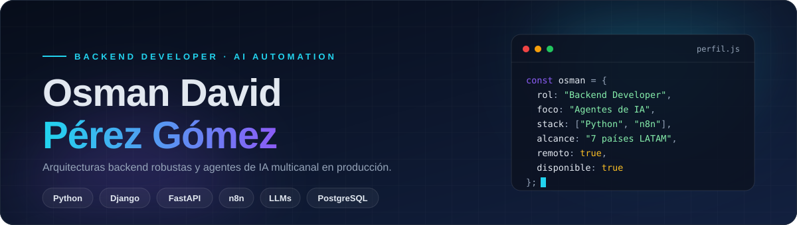

 

 

  

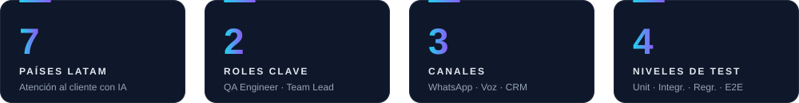

 

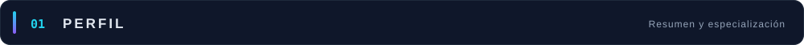

 

Desarrollador **backend** e ingeniero de **automatización con IA**. Diseño e implemento **arquitecturas de software robustas** y **agentes de IA multicanal** (WhatsApp, voz, CRM) en **entornos de producción**, garantizando la estabilidad del sistema con pruebas unitarias, de integración y de extremo a extremo. Lidero técnicamente proyectos con metodología **Scrum**.

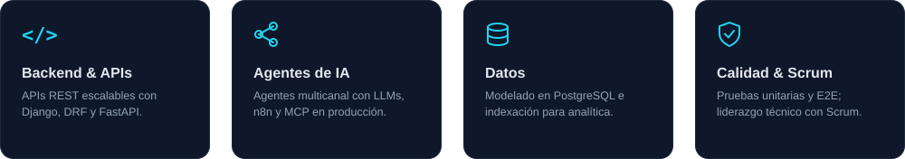

 

<table>
  <tr>
    <td width="33%" valign="top"><b>CONSTRUYENDO</b> Agentes de IA multicanal y arquitecturas backend escalables.</td>
    <td width="33%" valign="top"><b>APRENDIENDO</b> Ingeniería de Sistemas, MCP y orquestación de agentes. Inglés conversacional B1 → B2.</td>
    <td width="33%" valign="top"><b>PREGÚNTAME SOBRE</b> Django, FastAPI, n8n, LLMs, PostgreSQL y testing de APIs.</td>
  </tr>
</table>

 

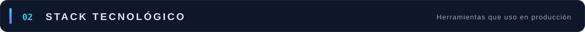

 

<table>
  <tr>
    <td width="190"><b>LENGUAJES</b></td>
    <td>
      
      
      
    </td>
  </tr>
  <tr>
    <td><b>BACKEND &amp; APIs</b></td>
    <td>
      
      
      
      
      
    </td>
  </tr>
  <tr>
    <td><b>DATOS</b></td>
    <td>
      
      
      
      
      
      
      
    </td>
  </tr>
  <tr>
    <td><b>IA &amp; AUTOMATIZACIÓN</b></td>
    <td>
      
      
      
      
      
      
    </td>
  </tr>
  <tr>
    <td><b>INTEGRACIONES</b></td>
    <td>
      
      
      
    </td>
  </tr>
  <tr>
    <td><b>TESTING &amp; QA</b></td>
    <td>
      
      
      
      
      
    </td>
  </tr>
  <tr>
    <td><b>DEVOPS &amp; ENTORNOS</b></td>
    <td>
      
      
      
      
      
    </td>
  </tr>
</table>

 

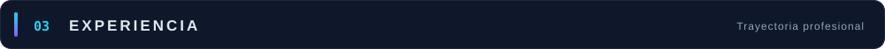

 

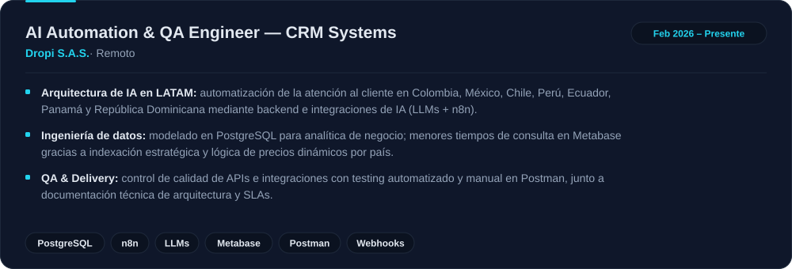

 

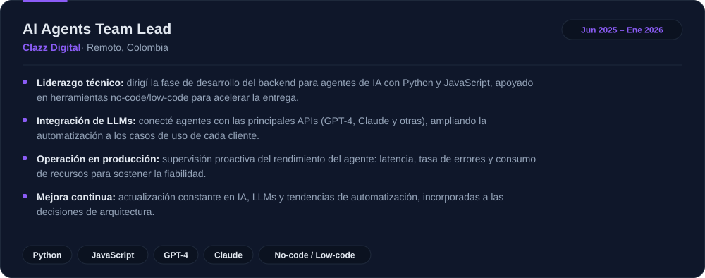

 

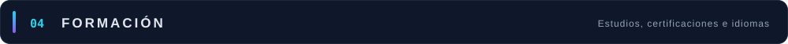

 

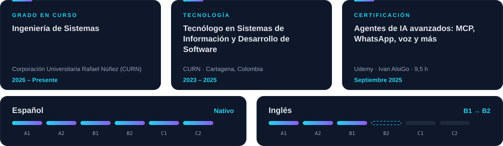

 

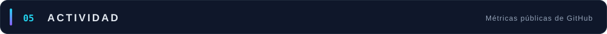

 

 

  

Gran parte de mi trabajo profesional vive en repositorios privados de empresas, por lo que no se refleja aquí.

 

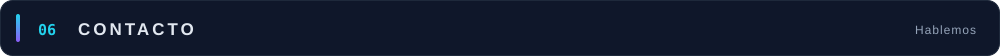

 

  

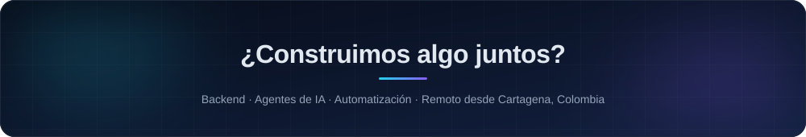

